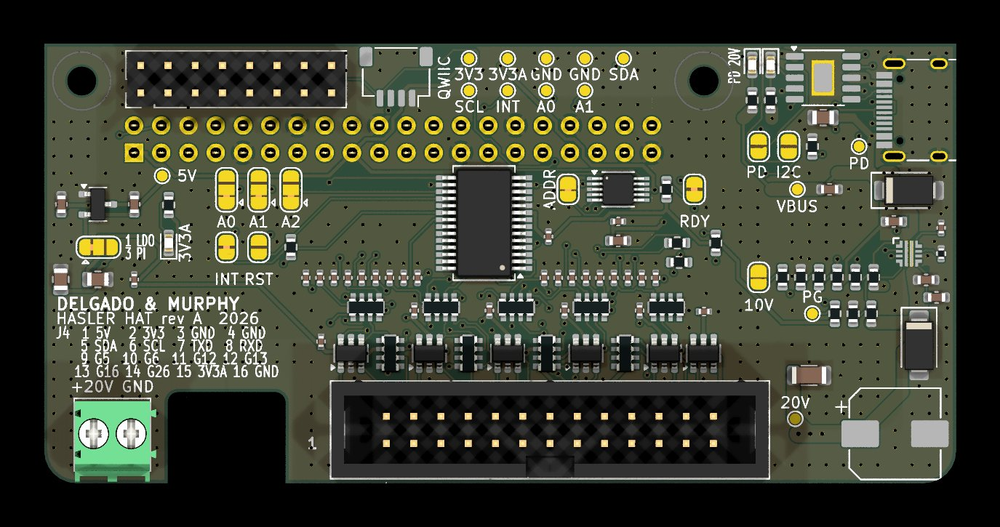

# Hasler Music Box

<sub><i>A Delgado &amp; Murphy restoration</i></sub>

A Swiss radio from the 1960s that plays music again.

The **Hasler HM** was built in Bern around 1964 for Telefónica's *Hilo Musical*,
a service that sent music to homes over the telephone line. Its piano keys chose
one of six music channels. Today the same keys play internet radio, Spotify and
YouTube Music, and the radio is a speaker for your phone. The keys, the knobs,
the pilot lamp and the original speaker all still work.

## What it can do

- **Press a key, hear music.** No phone, no app.
- **Nearly 600 radio stations** from about 120 countries, each one played on
  a Hasler before it went in.
- **A speaker for your phone:** Spotify, AirPlay, Bluetooth and other music
  apps. Guests on your Wi-Fi can play too.
- **Several rooms.** Two or more Haslers play the same music in step.
- **Two knobs, like the old radio.** Volume, with a ceiling that protects the
  old speaker, and tone, which also switches the radio off.
- **A pilot lamp that talks:** amber for the radio, blue for a phone, a dim
  ember when asleep, dark when it is safe to unplug.
- **A key page** in your browser to choose the music on each key.
- **Safe updates** that install by themselves at night, and step back if
  something doesn't work.
- **Home Assistant**, if you want it. Everything works without it.

**Living with a Hasler?** [Using your Hasler](docs/using.md) starts with the
first ten minutes. The [pilot lamp](docs/lamp.md) has every colour, and
[Remote help](docs/remote-help.md) explains how the makers can look at your
radio from afar, only when you say so.

What changed in each version: the
[releases page](https://delgado-murphy.github.io/hasler-releases/).

---

## For makers and contributors

<p align="center">
  
</p>

<!-- docs/img/hasler.jpg is a render of the HAT board for now; swap in a photo of the finished cabinet when there is one. -->

Inside: a Raspberry Pi, a modern amplifier and our own board (the Hasler
HAT), wired to the cabinet's original keys, knobs, lamp and speaker.

| You are... | Read this |
|---|---|
| **Building one** | [Build guide](docs/build-guide.md), then [Hardware](docs/hardware.md) |
| **Helping with the code** | [Contributing](docs/contributing.md) |
| **Curious what changed** | [Releases](https://delgado-murphy.github.io/hasler-releases/) and the [changelog](CHANGELOG.md) |

**For makers**

- [Build guide](docs/build-guide.md): from an empty cabinet to a working radio, step by step.
- [A new SD card](docs/new-install.md): the radio's software from a blank card, headless, from a signed release.
- [Hardware](docs/hardware.md): parts list, wiring, power and protection.
- [The knobs' sound effects](docs/sound.md): the tone knob's effects and how a cabinet's knobs get them.
- [Multiroom and casting](docs/multiroom.md): how Haslers play in step (Snapcast), room names, AirPlay, UPnP, Bluetooth, Spotify.
- [The pilot lamp](docs/lamp.md): the light language, and the design the code follows.
- [Remote help](docs/remote-help.md): the makers' side, the tailnet and approving a radio.
- [Hasler HM panel survey](docs/variants/hasler-hm.md): measuring this cabinet's keys, knobs and speaker.
- [Prototype board](docs/prototype/README.md), and the Hasler HAT: [brief](docs/hat/BRIEF.md), [design](docs/hat/DESIGN.md), [ordering and bring-up](hardware/hat/ORDERING.md).

**For contributors and maintainers**

- [Contributing](docs/contributing.md): code layout, tests, how a cabinet's panel is described.
- [Over-the-air updates](docs/ota.md): how updates stay safe.
- [Releasing](docs/release.md): how a new version is built, signed and published.
- [OTA formats](docs/ota-format.md): the exact file formats (a contract between the builder and the radio).

### How it works, in one picture

```
keys ───▶ MCP23017 (or Pi GPIO) ──┐
knobs ──▶ ADS1115 ────────────────┤
                                  ▼
                               haslerd ──▶ pilot lamp
                    ┌─────────────┼──────────────┬───────────────────┐
                    ▼             ▼              ▼                   ▼
             MPD (moOde)    go-librespot     key page :8080    Home Assistant
          radio, YouTube      Spotify                            (optional)
              Music

MPD │ go-librespot │ Bluetooth │ AirPlay │ UPnP ──▶ Amp4 Pro (hardware mixer = the knob) ──▶ original speaker
                         │
                         └─ in a group: Snapcast ──▶ the other Haslers (each through its own amp and knob)
```

`haslerd` is our small service on the Pi. It reads the keys and knobs, starts
the music, drives the lamp and serves the key page. The music system underneath
is [moOde audio](https://moodeaudio.org/). Bluetooth, AirPlay (shairport-sync)
and UPnP come from moOde; Spotify comes from go-librespot; YouTube Music
streams are found by yt-dlp; the tone knob's effects run in CamillaDSP
([sound.md](docs/sound.md)). Several Haslers play in step through
[Snapcast](https://github.com/badaix/snapcast) ([multiroom.md](docs/multiroom.md)).

**More cabinets are coming.** An *Excelsior* and others are waiting, and their
panels work differently (for example, keys that lock down). So the panel is
**data, not code**: one service, a few control types, and one YAML file per
cabinet in `config/variants/`.

### Licence

Hasler's code is [MIT](LICENSE). Two exceptions: the moOde patch in
`config/moode/` is GPL-3.0-or-later, because it changes moOde
([config/moode/LICENSE](config/moode/LICENSE)), and the HAT hardware design in
`docs/hat/` is [CERN-OHL-P-2.0](docs/hat/LICENSE). Releases also bundle
go-librespot (GPL-3.0), Deno (MIT), two fonts (SIL OFL 1.1) and Python
packages under their own licences; [THIRD_PARTY_NOTICES.md](THIRD_PARTY_NOTICES.md)
lists them, and every release carries it with the full texts in `licenses/`.

---

<sub>Delgado &amp; Murphy · Hasler HM, Bern 1964 — restored 2026</sub>
