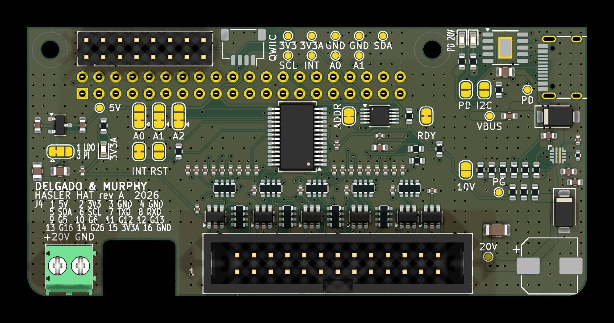

# Hasler Music Box

<sub><i>A Delgado &amp; Murphy restoration</i></sub>

<p align="center">
  
</p>

A Swiss radio from the 1960s that plays music again.

The **Hasler HM** was built in Bern around 1964 for Telefónica's *Hilo Musical*,
a service that sent music to homes over the telephone line. Its piano keys chose
one of six music channels. We took out the old electronics and put a small
computer (a Raspberry Pi) and a modern amplifier inside. The keys, the knobs,
the pilot lamp and the original speaker all still work.

<!-- docs/img/hasler.jpg is a render of the HAT board for now; swap in a photo of the finished cabinet when there is one. -->

## What it can do

- **Press a key, hear music.** Each of the six keys plays an internet radio
  station, a Spotify playlist or a YouTube Music playlist. No phone, no app.
- **Be a speaker for your phone** with Spotify Connect (guests on your Wi-Fi
  too), AirPlay, Bluetooth or other music apps (UPnP/DLNA). It remembers your
  Bluetooth phones and calls the last one when you switch to Bluetooth.
- **Play in several rooms.** Two or more Haslers play the same music in step:
  tap *Also play on…* and the kitchen joins the living room. Each radio keeps
  its own volume and its own room name (*Hasler Kitchen*).
- **Two knobs, like the old radio.** Volume works for everything, with a
  ceiling that protects the old speaker. Tone makes the sound warmer or
  brighter (or one of several other effects), and clicks off to put the radio
  to sleep.
- **A pilot lamp that talks:** amber for the radio, blue for a phone, a dim
  ember when asleep, dark when it is safe to unplug.
- **A key page** in your browser (`http://hasler.local:8080`) to choose the
  music on each key and change settings.
- **Safe updates.** Small ones install by themselves at night, in standby;
  bigger ones ask first. If an update doesn't work, the radio goes back to the
  version before by itself.
- **Home Assistant**, if you want it: a held key can run a scene or set the
  lights, and the [Hasler Radio integration](https://github.com/Delgado-Murphy/hasler-homeassistant)
  shows each radio in Home Assistant. Everything else works without it.

New to your Hasler? [Using your Hasler](docs/using.md) starts with the first
ten minutes.

## Where to start

| You are... | Read this |
|---|---|
| **Living with a Hasler** and want to know how to use it | [Using your Hasler](docs/using.md) |
| **Building one** | [Build guide](docs/build-guide.md), then [Hardware](docs/hardware.md) |
| **Helping with the code** | [Contributing](docs/contributing.md) |
| **Curious what changed** | [Releases](https://delgado-murphy.github.io/hasler-releases/) and the [changelog](CHANGELOG.md) |

## All the documents

**For owners**

- [Using your Hasler](docs/using.md): the first ten minutes, keys, knobs, lamp, phones, several rooms, the key page, Wi-Fi, updates, and what to do when something is wrong.
- [The pilot lamp](docs/lamp.md): every colour and what it means, in detail.

**For makers**

- [Build guide](docs/build-guide.md): from an empty cabinet to a working radio, step by step.
- [A new SD card](docs/new-install.md): the radio's software from a blank card, headless, from a signed release.
- [Hardware](docs/hardware.md): parts list, wiring, power and protection.
- [The knobs' sound effects](docs/sound.md): the tone knob's effects and how a cabinet's knobs get them.
- [Multiroom and casting](docs/multiroom.md): how Haslers play in step (Snapcast), room names, AirPlay, UPnP, Bluetooth, Spotify.
- [Hasler HM panel survey](docs/variants/hasler-hm.md): measuring this cabinet's keys, knobs and speaker.
- [Prototype board](docs/prototype/README.md) and the [HAT design brief](docs/hat/BRIEF.md).

**For contributors and maintainers**

- [Contributing](docs/contributing.md): code layout, tests, how a cabinet's panel is described.
- [Over-the-air updates](docs/ota.md): how updates stay safe.
- [Releasing](docs/release.md): how a new version is built, signed and published.
- [OTA formats](docs/ota-format.md): the exact file formats (a contract between the builder and the radio).

## How it works, in one picture

```
keys ───▶ MCP23017 (or Pi GPIO) ──┐
knobs ──▶ ADS1115 ────────────────┤
                                  ▼
                               haslerd ──▶ pilot lamp
                    ┌─────────────┼──────────────┬───────────────────┐
                    ▼             ▼              ▼                   ▼
             MPD (moOde)    go-librespot     key page :8080    Home Assistant
          radio, YouTube      Spotify                            (optional)
              Music

MPD │ go-librespot │ Bluetooth │ AirPlay │ UPnP ──▶ Amp4 Pro (hardware mixer = the knob) ──▶ original speaker
                         │
                         └─ in a group: Snapcast ──▶ the other Haslers (each through its own amp and knob)
```

`haslerd` is our small service on the Pi. It reads the keys and knobs, starts
the music, drives the lamp and serves the key page. The music system underneath
is [moOde audio](https://moodeaudio.org/). Bluetooth, AirPlay (shairport-sync)
and UPnP come from moOde; Spotify comes from go-librespot; YouTube Music
streams are found by yt-dlp; the tone knob's effects run in CamillaDSP
([sound.md](docs/sound.md)). Several Haslers play in step through
[Snapcast](https://github.com/badaix/snapcast) ([multiroom.md](docs/multiroom.md)).

**More cabinets are coming.** An *Excelsior* and others are waiting, and their
panels work differently (for example, keys that lock down). So the panel is
**data, not code**: one service, a few control types, and one YAML file per
cabinet in `config/variants/`.

## Licence

Hasler's code is [MIT](LICENSE). Two exceptions: the moOde patch in
`config/moode/` is GPL-3.0-or-later, because it changes moOde
([config/moode/LICENSE](config/moode/LICENSE)), and the HAT hardware design in
`docs/hat/` is [CERN-OHL-P-2.0](docs/hat/LICENSE). Releases also bundle
go-librespot (GPL-3.0), Deno (MIT), two fonts (SIL OFL 1.1) and Python
packages under their own licences; [THIRD_PARTY_NOTICES.md](THIRD_PARTY_NOTICES.md)
lists them, and every release carries it with the full texts in `licenses/`.

---

<sub>Delgado &amp; Murphy · Hasler HM, Bern 1964 — restored 2026</sub>
