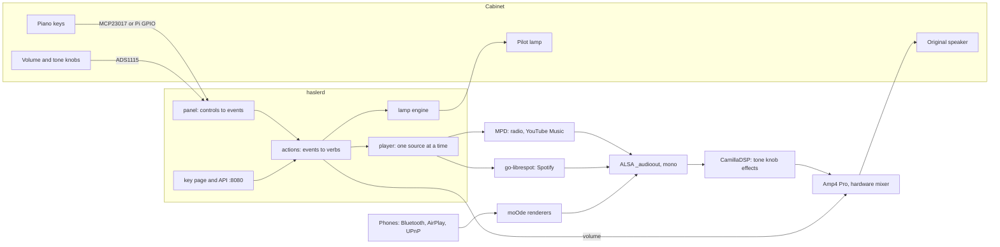
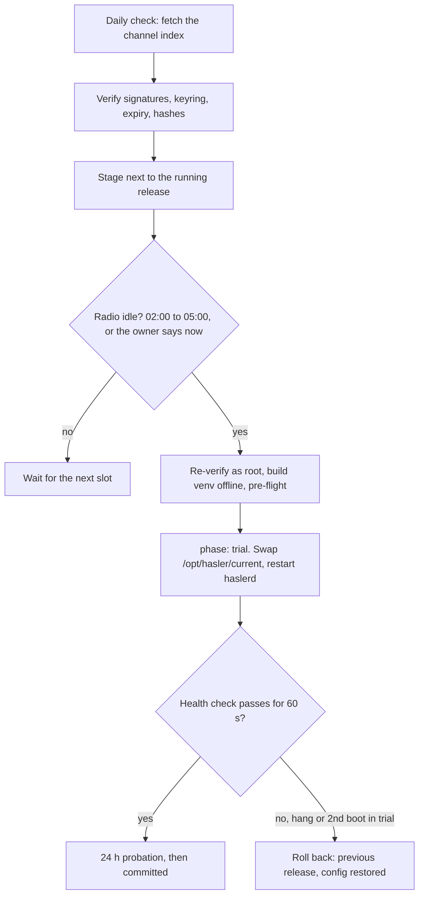
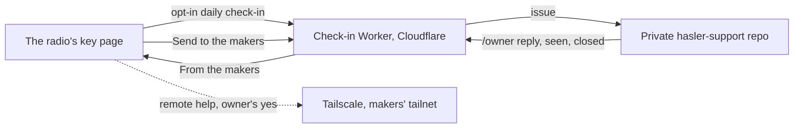

# How the radio works

One page on the moving parts of a Hasler, for makers and contributors. Each
part links to its own doc, where the details live. If you only want to use a
Hasler, see [Using your Hasler](using.md).

## The big picture

A Raspberry Pi 4 runs [moOde audio](https://moodeaudio.org/) (Raspberry Pi OS
with MPD and a web UI). On top of it runs **`haslerd`**, our own service. It
reads the keys and knobs, starts the music, drives the pilot lamp and serves
the key page. Under everything, one sound card: the Amp4 Pro, whose
**hardware mixer** is the volume knob for every player.

The rules that shape the code:

- **The radio works alone.** No internet, no Home Assistant, no phone needed
  to press a key and hear a station. Every outside service is optional.
- **A key press never waits on the network.** Slow work goes to a background
  thread; errors are logged and swallowed at the boundary (`actions.py`).
- **The panel is data, not code.** One YAML file per cabinet in
  `config/variants/` says which chip reads which key and what each key does.
- **We own our service, not moOde's.** haslerd talks to moOde through its
  database, its forms and MPD; moOde's own files are never edited.

## Keys, knobs and the panel

The main loop polls the panel at 50 Hz. Every control is a pure function of
(time, input snapshot) → events, so a 5-second hold costs nothing to test.
Six control types cover the cabinets we know: `momentary`, `latching_toggle`,
`interlocked_bank`, `rotary_switch`, `pot`, `analog_selector`. Events such as
`k3.tap` or `tone.change` are looked up in the descriptor's `actions:` table
(`{do: preset, n: 3}`), so rebinding a key is a config edit.

Where the code is: `daemon/haslerd/panel/` (input backends `io_*.py`, the
controls in `controls.py`), `daemon/haslerd/actions.py`, `daemon/haslerd/main.py`
(the loop), `daemon/haslerd/variant.py`, `config/variants/*.yaml`.
More: [Contributing, "Describing a cabinet"](contributing.md#describing-a-cabinet),
[Hasler HM panel survey](variants/hasler-hm.md).

## Sources: where the music comes from

Only one player can hold the sound card, so a small router in
`player/moode.py` keeps exactly one source playing.

| Source | What plays it | Notes |
|---|---|---|
| **Radio** | MPD | A stream URL from the station collection (`config/stations/collection.json`; starter sets in `config/presets/`). |
| **YouTube Music** | MPD, through a local redirect proxy | The MPD queue holds stable `http://127.0.0.1:<port>/ytm/<id>` URLs. When MPD asks for one, yt-dlp (with deno as its JavaScript runtime) resolves it and the proxy answers `302` to YouTube. No audio passes through Python. yt-dlp updates itself on its own signed lane. |
| **Spotify** | go-librespot, over its local HTTP API | It holds its own login, so a key can start a playlist with no phone. moOde's own librespot stays off. |
| **Phones** | moOde's renderers: Bluetooth (bluealsa), AirPlay (shairport-sync), UPnP (upmpdcli) | moOde starts and stops them and stops MPD while a phone plays; haslerd reads that state and switches renderers through moOde's own form (`renderers.py`). |

Where the code is: `daemon/haslerd/player/` (`moode.py`, `renderers.py`,
`bluetooth.py`), `player/sources/` (`radio.py`, `spotify.py`, `ytm.py`,
`ytmusic.py`, `ytm_browse.py`), `daemon/haslerd/ytdlp_lane.py`,
`scripts/hasler-ytdlp-update`, `config/go-librespot/`.
More: [build guide, Phase 3c](build-guide.md#phase-3c--streaming-sources-spotify--youtube-music),
[the yt-dlp lane](ota.md#the-component-lane-yt-dlp).

## The sound path: ALSA, CamillaDSP, the amp

Every player plays into moOde's ALSA device `_audioout`. That one name is
where we change things, below every player:

- **Mono.** The cabinet has one speaker on the left channel.
  `scripts/hasler-audio-mono` (root, through sudoers) adds an override of
  `_audioout` that mixes left and right (`daemon/haslerd/audio.py`).
- **The tone knob.** Each pot except volume can carry a sound effect (tilt,
  treble, bass, vintage, loudness ...). `dsp/knobs.py` renders the whole
  chain on a worker thread and `scripts/hasler-dsp` hands it to CamillaDSP
  over its websocket. It is never louder than flat.
- **Volume** is the Amp4 Pro's hardware mixer (`amixer`), so one knob governs
  MPD, Spotify, Bluetooth and AirPlay alike, under a ceiling that protects the
  old speaker.

Where the code is: `daemon/haslerd/audio.py`, `daemon/haslerd/dsp/`,
`scripts/hasler-audio-mono`, `scripts/hasler-dsp`, `config/camilladsp/`.
More: [The knobs' sound effects](sound.md), [Hardware](hardware.md).

## The pilot lamp

An RGB lamp behind the cabinet's window says what the radio is doing: amber
for the radio, blue for a phone, a dim ember when asleep, dark when it is safe
to unplug, plus short replies to each key. A policy turns the radio's state
into a *look*; an engine fades between looks; outputs drive the GPIO pins.
Actions tell the lamp through hooks and never import it.

Where the code is: `daemon/haslerd/lamp/`, `daemon/haslerd/hw/gpio_lamp.py`,
`scripts/hasler-lamp-boot`, `scripts/hasler-lamp-halt`.
More: [The pilot lamp](lamp.md).

## The key page

One HTML file, `daemon/haslerd/web/static/index.html`, with no build step,
and a small JSON API on Python's standard `http.server`. There is no login:
the page trusts the home network, as moOde's own UI does. The same API is
the remote control (`/api/press`, `/api/volume`), and a pressed key on the
page is dispatched as the same event the panel would send.

- haslerd listens on **port 8080**. `scripts/hasler-web-front` adds one site to
  moOde's nginx so **port 80** (`http://hasler.local`) reaches haslerd and
  moOde's pages move to **:8081**. Every ten minutes haslerd checks that port 80 still reaches it, and puts the
  site back after a moOde update (`web/front.py`).
- **MPD and CamillaDSP answer the radio only.** moOde lets MPD (6600) and
  CamillaDSP's websocket (1234) listen on every address, with no password -
  anyone on the Wi-Fi could turn the volume past the ceiling.
  `scripts/hasler-local-only` puts both on 127.0.0.1 before every MPD start (a
  drop-in for `mpd.service`) and at haslerd's start; `/api/health` lists any
  still reachable from the network in `exposed_controls`. Nothing of the radio
  used them from outside: haslerd, moOde's pages, UPnP and CamillaGUI talk to
  them on the radio itself.
- **Wi-Fi setup.** With no known network at boot, moOde starts the "Hasler"
  hotspot; a captive portal (`config/captive/`) sends the phone to haslerd's
  `/wifi` page, and `scripts/hasler-wifi-join` joins the network.

Where the code is: `daemon/haslerd/web/` (`server.py`, one `*_api.py` per
area), `scripts/hasler-web-front`, `scripts/hasler-wifi-join`.
More: [build guide, "The key page on port 80"](build-guide.md#the-key-page-on-port-80),
[Moving the radio to a new Wi-Fi network](build-guide.md#moving-the-radio-to-a-new-wi-fi-network).

## Updates over the air

Releases are built by GitHub Actions in this repo, then checked, **signed**
and published by the public `hasler-releases` repo (artifacts and signed
channel indexes on GitHub Pages). On the radio, `hasler-update` (stdlib
Python, so it can repair a release with a broken venv) does the rest.

- **Releases side by side.** `/opt/hasler/releases/<version>/`, with
  `current` and `previous` symlinks swapped atomically; three are kept.
- **Config is separate from code.** `/etc/hasler/box.yaml` (overrides only)
  and `variant.d/` (this radio's calibration); `/var/lib/haslerd/` (keys,
  settings, secrets). Updates never overwrite them; schema changes come as
  migrations (`daemon/haslerd/migrations/`).
- **Trial and rollback.** `hasler-update-boot.service` runs before haslerd: a
  second boot still in trial rolls back before haslerd starts. A power cut at
  any step lands on a working version.
- **Debian security fixes** come on their own lane, `scripts/hasler-os-update`,
  at night, only from `<codename>-security`.

Where the code is: `update/hasler_update/` (`check.py`, `verify.py`,
`stage.py`, `apply.py`, `boot.py`, `health.py`), `update/systemd/`,
`scripts/release/`, `.github/workflows/release.yml`, `scripts/hasler-os-update`.
More: [Over-the-air updates](ota.md), [OTA formats](ota-format.md),
[Releasing](release.md), [A new SD card](new-install.md).

## Several rooms (multiroom)

Off by default. Every radio announces itself over mDNS as `_hasler._tcp`
(port 8080, `/api/info`). On the leader's key page, "Also play on" ticks other
Haslers. Each radio is `alone`, `lead` or `follow`, and always boots alone.

The audio is [Snapcast](https://github.com/badaix/snapcast). While grouped, a
file in `/run` points `_audioout` at an ALSA Loopback; `snapserver-hasler`
captures it on the leader, and `snapclient-hasler` on every radio (the leader
included) plays the stream into its own card. Volume stays on each radio's own
knob (`--mixer none`).

Where the code is: `daemon/haslerd/multiroom/` (`peers.py`, `group.py`,
`audio.py`), `scripts/hasler-multiroom`, `config/snapcast/`,
`config/snapserver-hasler.service`, `config/snapclient-hasler.service`,
`config/avahi/hasler.service`.
More: [Multiroom and casting](multiroom.md).

## Home Assistant

Optional; the radio works the same without it. Two directions:

- **Keys to HA.** A key can run a scene or a service, or switch a light
  (`ha_scene`, ...), over HA's REST API, fire-and-forget on a background
  thread. haslerd finds HA over mDNS and follows it if its address changes
  (only the same HA instance gets the token).
- **The radio in HA.** The Hasler integration, a separate repo
  (`hasler-homeassistant`), finds radios as `_hasler._tcp` and reads the
  radio's own API (`/api/status`, `/api/info`, `/api/art/current`).

Where the code is: `daemon/haslerd/ha/`, `daemon/haslerd/web/ha_api.py`.
More: [build guide, Phase 5](build-guide.md#phase-5--home-assistant),
[Multiroom, "Home Assistant"](multiroom.md#home-assistant).

## Help and support

- **Tell the makers** builds a short report with nothing private in it
  (`web/report.py`). **Send to the makers** (every radio, out of the box)
  posts it to the Worker with the radio's own token, which files it as an
  issue in the private `hasler-support` repo. A maker's `/owner ...` comment comes back to the
  radio as a note; owners never need a GitHub account.
- **The daily check-in** (off until the owner turns it on) sends about half a
  kilobyte of health facts and nothing about where the radio is or what it
  plays (`update/hasler_update/checkin.py`). The Worker keeps one row per
  radio and never reads the IP.
- **Remote help** starts only after a press on the radio. A temporary,
  in-memory Tailscale node joins the makers' tailnet for at most 24 hours.

Where the code is: `tools/checkin/` (`worker.js`, `support.js`, their
`node --test` tests), `daemon/haslerd/web/support_api.py`, `web/report.py`,
`web/help_api.py`, `scripts/hasler-help`.
More: [tools/checkin/README.md](../tools/checkin/README.md),
[tools/checkin/SUPPORT.md](../tools/checkin/SUPPORT.md),
[Remote help](remote-help.md),
[build guide, "Support"](build-guide.md#support-what-the-owner-can-send-you-and-what-you-leave-behind).

## Running it on a laptop

`haslerd --fake` runs the whole service with an in-memory panel and player,
so the key page and its API work without a Pi. The tests need no hardware
either; [Contributing](contributing.md) has the commands.

---

Delgado &amp; Murphy
