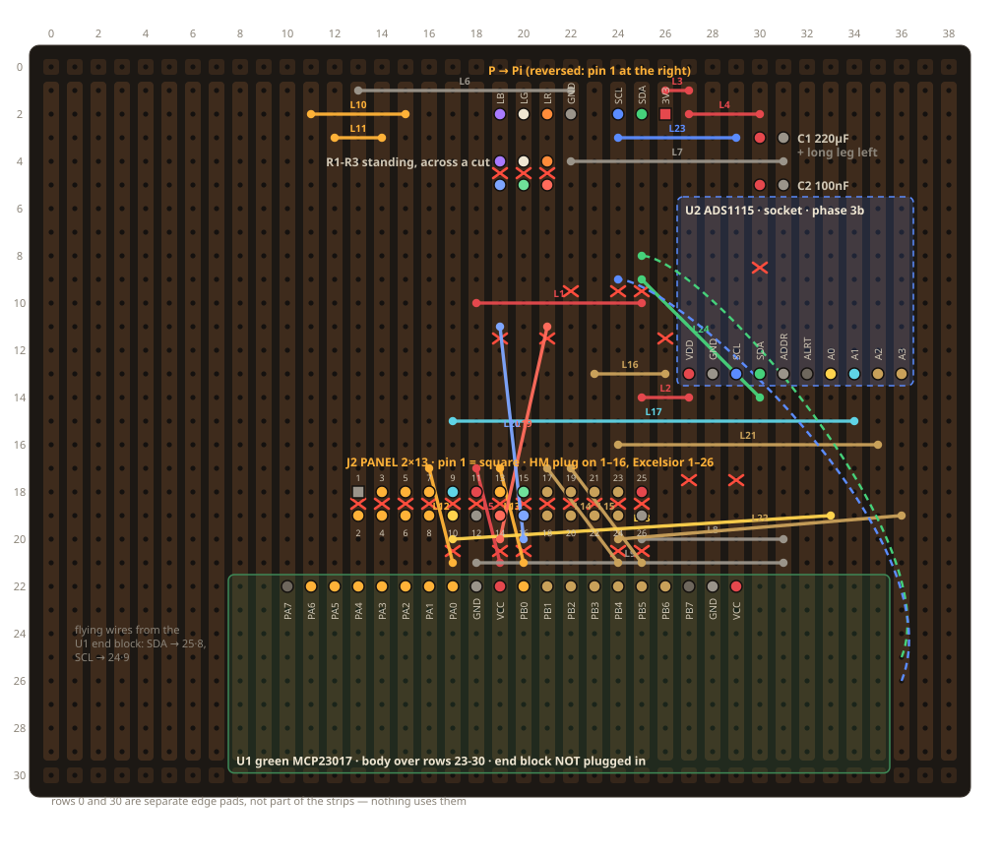

# Prototype board — stripboard layout

*For makers.* This is the hand-built board inside our radio today: it carries
the chips that read the keys and knobs, and the pilot lamp's resistors. It will
be replaced by the [HAT](../hat/BRIEF.md). The files here draw it and check it.

Velleman ECL1/2 stripboard (39 strips along the 80 mm side, 29 holes each; rows 0 and 30 are separate edge pads) carrying the
green MCP23017, the ADS1115 socket, the Pi header P, and J2 — the 26-pin Hasler connector (pins 1–16 the HM standard, 17–26 expansion). Paper page "4 · Prototype board", sheet PB3.

To regenerate the layout and the drawing:

    KMAP=K6,K2,K4 EMAP=EXP1,EXP3,EXP5 UX=27 UY=13 PP="19 2 1" CC="30 3" \
        python3 stripboard_layout.py stripboard_layout.json
    python3 stripboard_render.py stripboard_layout.json stripboard.svg

The layout script places the parts, derives the track cuts, routes wire links that never
overlap, and checks with a union-find that every strip piece carries exactly one net and
every net is one piece. Keys are mapped to the MCP pin their J2 wire lands on (the descriptor follows). Output: 30 cuts, 24 links.
